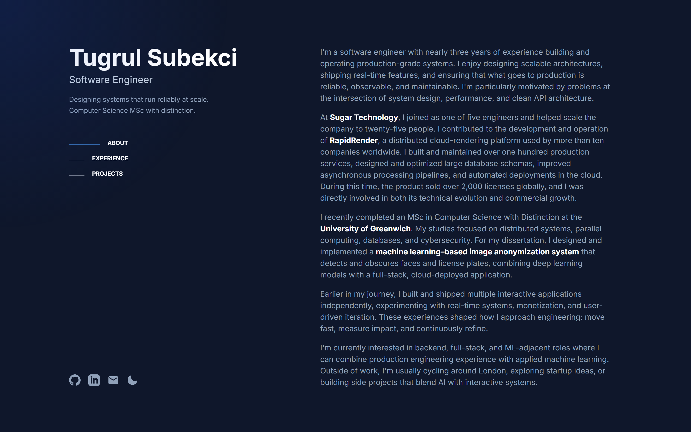
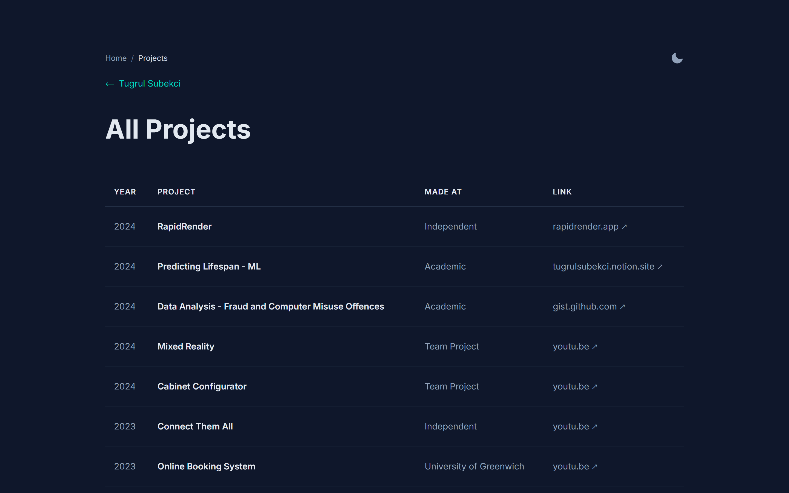
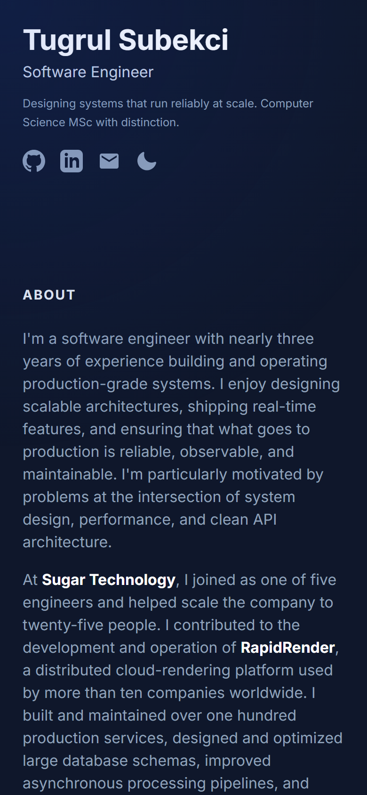
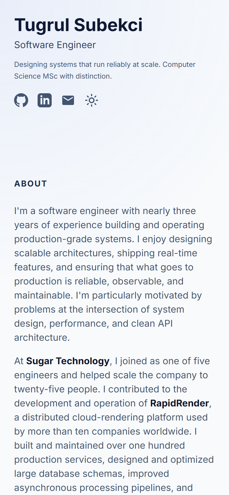

<div align="center">

# Tugrul Subekci — Portfolio

**The source of [tugrulsubekci.com](https://tugrulsubekci.com)**: a fast, accessible personal site, built and shipped like a production product.

[](https://github.com/tugrulsubekci/portfolio/actions/workflows/ci.yml)


[**Live site**](https://tugrulsubekci.com) · [**Storybook**](https://storybook.tugrulsubekci.com) · [**Project archive**](https://tugrulsubekci.com/archive)

<br />

<picture>
  <source media="(prefers-color-scheme: light)" srcset="docs/home-light.png" />
  
</picture>

</div>

---

## Highlights

| | |
|---|---|
| **Quality gates on every PR** | Lint, typecheck, unit tests, production build, Storybook build, and Lighthouse CI on mobile *and* desktop. A PR that regresses accessibility or SEO below 100 fails. |
| **A real design system** | Every UI part is built on [shadcn/ui](https://ui.shadcn.com) primitives (Radix under the hood). The site's own look lives in typed `cva` variants, so the primitives stay stock and upgradeable. |
| **Documented in Storybook** | Each component has stories in dark and light themes, deployed to [storybook.tugrulsubekci.com](https://storybook.tugrulsubekci.com). |
| **Synced to Claude Design** | The same compiled components are published to a Claude Design project, and each preview there is checked pixel by pixel against Storybook. AI-generated designs use the real components, not lookalikes. |
| **Themes without a flash** | Dark and light themes run on semantic CSS tokens. A tiny inline script sets the theme before first paint and follows the OS setting until you choose one yourself. |
| **Accessible by default** | Keyboard-reachable controls, Radix tooltips, landmark navigation, and full respect for `prefers-reduced-motion`. |
| **SEO done properly** | Per-page metadata and canonicals, JSON-LD `Person` schema, a generated sitemap, robots rules, and dynamic Open Graph / Twitter images generated at build time. |
| **Content as data** | Profile, experience and projects are typed TypeScript modules. Adding a project is one object, and `featured: true` puts it on the home page. |

## Performance budget

Lighthouse CI runs three times per page (`/` and `/archive`) against the production build. The build fails below these scores:

| Category | Mobile | Desktop |
|---|:-:|:-:|
| Performance | ≥ 90 | ≥ 95 |
| Accessibility | **100** | **100** |
| Best practices | ≥ 95 | ≥ 95 |
| SEO | **100** | **100** |

Reports are uploaded as CI artifacts on every run.

## Architecture

```text
src/
├── app/                 App Router pages, layout, sitemap, manifest, OG/Twitter images
├── components/
│   ├── ui/              shadcn/ui primitives + site-style variants (button, card, table, breadcrumb, tooltip…)
│   ├── atoms/           smallest site pieces: links, icons, theme toggle, spotlight
│   ├── molecules/       cards, rows, nav links, breadcrumbs, social links
│   ├── organisms/       page sections: sidebar, about, experience, projects, archive table
│   └── templates/       page layouts (home, archive)
├── data/                typed site content: profile, experience, projects, navigation, social
├── hooks/               useActiveSection (IntersectionObserver scroll-spy)
└── lib/                 site constants, theme script, project helpers, OG image renderer
```

**Atomic design on top of shadcn.** Site components are composed from the `ui/` primitives rather than hand-rolled markup. The site's visual language lives in variants:

```tsx
// A stock shadcn Button, rendering the site's teal arrow link
<Button variant="brand-link" asChild>
  <Link href="/archive">View full project archive <ArrowIcon /></Link>
</Button>

// A shadcn Card as the hoverable project tile
<Card variant="interactive" asChild>
  <ExternalLink href={project.url}>…</ExternalLink>
</Card>
```

Site variants (`quiet`, `nav`, `brand-link`, `heading-link`, `interactive`, `outline`) carry no shadcn box or padding, and `tailwind-merge` resolves overrides, so call sites stay short and predictable.

**Semantic tokens.** Colours are named by role (`page`, `surface`, `heading`, `body`, `brand`, `indicator`, `line`…) in `src/app/globals.css` and swapped per theme with `data-theme`. Components never reference raw palette colours, and shadcn's own tokens are mapped onto the same set.

**Small, deliberate client JavaScript.** Pages are statically generated. Client components are limited to what has to be interactive: the theme toggle, scroll-spy navigation, and the cursor spotlight. The spotlight writes to the DOM inside `requestAnimationFrame` instead of React state, so moving the mouse never re-renders the page.

## Screenshots

<table>
  <tr>
    <td width="70%"></td>
    <td width="15%"></td>
    <td width="15%"></td>
  </tr>
  <tr>
    <td align="center"><sub>Project archive</sub></td>
    <td align="center"><sub>Mobile · dark</sub></td>
    <td align="center"><sub>Mobile · light</sub></td>
  </tr>
</table>

## Tech stack

| Area | Tools |
|---|---|
| Framework | Next.js 16 (App Router, static generation), React 19, TypeScript |
| Styling | Tailwind CSS v4, semantic CSS custom properties, `tw-animate-css` |
| Components | shadcn/ui (Radix primitives), class-variance-authority, lucide icons |
| Docs | Storybook 10 (`@storybook/nextjs-vite`) |
| Testing | Vitest, ESLint (flat config, Next + Storybook rules), `tsc --noEmit` |
| Quality | Lighthouse CI (mobile + desktop budgets) |
| CI/CD | GitHub Actions; Vercel previews per PR and production on `main` |
| Hosting | Vercel (site and Storybook as separate projects), Cloudflare DNS |
| Design | Claude Design project synced from the component library |

## Getting started

Requires **Node.js 24**.

```bash
npm ci
npm run dev        # http://localhost:3000
```

| Command | What it does |
|---|---|
| `npm run dev` | Start the dev server |
| `npm run build` / `npm start` | Production build and serve |
| `npm run lint` | ESLint |
| `npm run typecheck` | TypeScript, no emit |
| `npm test` | Vitest unit tests (`npm run test:watch` for watch mode) |
| `npm run storybook` | Component catalogue on http://localhost:6006 |
| `npm run build-storybook` | Static Storybook build |
| `npm run lighthouse` | Lighthouse CI, mobile then desktop (run after `npm run build`) |

### Editing content

- **Projects:** add an entry to `src/data/projects.ts`; `featured: true` shows it on the home page, and every project appears in the archive.
- **Experience / profile / links:** `src/data/experience.ts`, `profile.ts`, `social.ts`.
- **Colours:** theme tokens in `src/app/globals.css`.

### Adding UI

Check [shadcn/ui](https://ui.shadcn.com/docs/components) first. If a primitive fits, add it with `npx shadcn@latest add <name>`, give it a site-style variant where needed, and write a story. Build a custom component only when nothing fits.

## Delivery

```text
PR ─▶ GitHub Actions: lint · typecheck · test · build · Storybook · Lighthouse (mobile + desktop)
   └▶ Vercel preview deployments for the site and Storybook
main ─▶ Vercel production: tugrulsubekci.com + storybook.tugrulsubekci.com
```

Storybook redeploys only when components, stories or their config change, and it is kept out of search engines.

---

<div align="center">

Designed and built by **Tugrul Subekci** · [tugrulsubekci.com](https://tugrulsubekci.com) · [GitHub](https://github.com/tugrulsubekci) · [LinkedIn](https://linkedin.com/in/tugrulsubekci)

</div>
